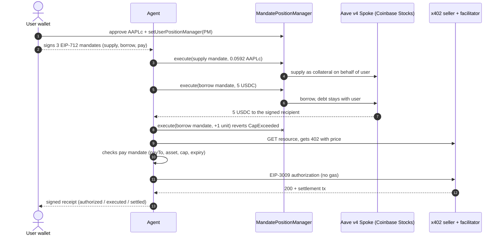

# Agent mandate · tokenized stocks as collateral + x402 payment

> **Testnet / local fork only. Unaudited. Not financial advice.**

A proof of concept where an AI agent:

1. supplies **AAPLc** (Coinbase tokenized Apple stock) as collateral on **Aave v4** (Coinbase Stocks spoke, Base 8453),
2. borrows **5 USDC** against it,
3. pays an **x402** endpoint with that USDC,

all under an **EIP-712 mandate signed by the user** (action, asset, cumulative cap, recipient, expiry, nonce), and leaves a **signed receipt** of what the user authorized, what the agent executed and what was settled.

The agent never holds the collateral or the position. The user owns the Aave position and only enables a small position-manager contract that executes what the mandate allows. The contract holds no funds: whatever enters leaves in the same transaction.

Separately, the agent made a **real x402 payment of 0.001 test USDC on Base Sepolia**.

## Flow



## What was real and what ran on a fork

| Step | Network | Real? |
|---|---|---|
| Deploy + enable position manager | local anvil fork of Base mainnet | Fork only. Our contract was enabled by writing the Spoke's storage directly with `anvil_setStorageAt`, a fork shortcut. Untested on mainnet |
| User receives 0.0592 AAPLc | fork | Fork only. Taken from a real holder via `anvil_impersonateAccount` |
| Supply AAPLc, borrow 5 USDC, over-cap attempt rejected | fork | Real Aave v4 contracts, real AAPLc and USDC, real risk params, oracle price frozen at fork block 53124300 |
| Health factor 3.17, liquidation price ~US$108 (AAPL at US$343.43, ~68% drop) | fork | Read from the real Spoke and oracle state on the fork |
| x402 payment of 0.001 USDC to a local seller | fork | Official `@x402/evm` facilitator, `transferWithAuthorization` on forked USDC |
| x402 payment of 0.001 test USDC to a public demo endpoint (Buenos Aires weather) | **Base Sepolia (real testnet)** | **Real.** [`0x55f966b0…3024e8`](https://sepolia.basescan.org/tx/0x55f966b0ab4c195cd5cf142b7522f4fee7bcd88a71cd265f34d1db24ab3024e8), block 50583663, 2026-10-26 15:16 ART (18:16 UTC). Gas paid by the facilitator. Test USDC from Circle's public faucet |

Fork transaction hashes do not exist on any public explorer.

The pay mandate is checked off-chain by the agent runtime (destination, asset, cap, expiry) because the USDC is already in the agent's payment wallet. Supply and borrow are validated on-chain by the contract.

The Sepolia run of 2026-10-26 has no agent-signed receipt (the throwaway key died with the process). What can be verified is the user's mandate signature and the on-chain tx. The script now writes that receipt on new runs.

## How to run

Requirements: Node 20+, [Foundry](https://getfoundry.sh) (`forge`, `anvil`), git. Google Chrome only for the PNG cards.

```bash
npm ci
npm run setup:contracts        # clones forge-std v1.17.0 into contracts/lib
npm run build:contracts
npm run test:contracts         # mandate logic tests (mock Spoke and tokens)

npm run fork &                 # anvil fork of Base at block 53124300 on port 8546
npm run e2e:fork               # full flow on the fork, writes out/fork-run.json

npm run pay:sepolia            # optional: prints AGENT_ADDRESS and waits up to 45 min for test USDC
#   send Base Sepolia USDC to that address from https://faucet.circle.com (no account needed)
#   writes out/sepolia-payment.json

npm run receipt                # verifies all signatures, writes out/recibo.json, out/recibo.html, out/0*.png
```

No secrets are needed. Every wallet is generated in memory and discarded. Optional overrides are in `.env.example` (export them in your shell). Never put a real private key anywhere in this project.

Contract tests use mocks because `forge test`'s EVM does not implement Base's native B20 tokens (AAPLc has `0xef` code). Anvil does, so the real Aave v4 integration is exercised by `e2e:fork`.

`out/` ships the artifacts from the 2026-10-26 run. Running `e2e:fork` overwrites them with new fork hashes.

## Files

- `contracts/src/MandatePositionManager.sol`: Aave v4 position manager driven by EIP-712 mandates
- `contracts/test/MandatePositionManager.t.sol`: tests (cumulative cap, signature, agent, expiry, asset, recipient, revocation)
- `src/mandate.js`: EIP-712 mandate and receipt types, off-chain checks, plain-language risk text
- `src/x402-local-server.mjs`: local x402 seller and facilitator settling on the fork
- `scripts/e2e-fork.mjs`: full fork flow
- `scripts/pay-sepolia.mjs`: real x402 payment on Base Sepolia
- `scripts/build-receipt.mjs`: unified receipt and PNG cards

## Warnings

- **Unaudited contract.** `MandatePositionManager` is a PoC. Do not deploy it with real funds.
- **Testnet or local fork only.** Nothing here touched Base mainnet.
- **Not financial advice**, not an offer and not a recommendation to buy any asset.
- **Reg S eligibility.** Coinbase tokenized stocks are offered under Regulation S only in eligible jurisdictions, and the issuer can restrict or freeze tokens. Eligibility depends on your jurisdiction. It has **not** been confirmed for residents of Argentina.
- **Untested on mainnet.** On the fork our contract was enabled by writing the Spoke's storage directly, which is a shortcut. Aave v4's native position managers are already active on the Coinbase Stocks spoke on Base (Giver `0x9E81c2fDE4E34CAB3AB1667ca3c932dBAED95F08`, Taker `0x8481204E528735aF2F3391AD98f36E757A56D695`, Config `0xe90F830bEe4b190B4910e146908437075b0BDaaF`, `isPositionManagerActive` returns true). A mandate layer could be built on top of them, but that has not been built or tested.
- Testnet prices and rates are not realistic. Borrowing against a volatile asset can get your whole position liquidated.

---

## En castellano

**Qué es:** una prueba de concepto donde un agente deposita AAPLc (Apple tokenizada de Coinbase) como colateral en Aave v4, en Base, pide 5 USDC prestados y con eso paga un endpoint x402. Todo pasa bajo un mandato EIP-712 que firma el usuario (acción, activo, tope acumulado, destino, vencimiento) y queda un recibo firmado de lo autorizado, lo ejecutado y lo liquidado.

**Nunca custodiamos:** las acciones y la posición quedan a nombre del usuario. El agente opera a través de un contrato que el usuario habilita, solo puede hacer lo que se firmó y el contrato no retiene fondos.

**Qué fue real:** el pago x402 de 0,001 USDC de prueba en Base Sepolia ([ver tx](https://sepolia.basescan.org/tx/0x55f966b0ab4c195cd5cf142b7522f4fee7bcd88a71cd265f34d1db24ab3024e8)). El depósito, el préstamo, el rechazo por encima del tope y el pago x402 local corrieron en una copia local de Base mainnet (anvil), con los contratos reales de Aave v4 y el precio congelado en el bloque 53124300. Resultado: health factor 3,17 y precio de liquidación de AAPL cerca de US$108, una caída de ~68%.

**Cómo correrlo:** ver "How to run" arriba.

**Advertencias:**
- Contrato sin auditar. Solo testnet o fork.
- No es consejo financiero ni una oferta.
- La elegibilidad de las acciones tokenizadas (Reg S) depende de la jurisdicción y no está confirmada para residentes en Argentina.
- Sin probar en mainnet. En el fork habilitamos nuestro contrato escribiendo directo el storage del spoke, que es un atajo. Los position managers nativos de Aave v4 ya están activos en el spoke de Coinbase Stocks y un mandato podría montarse encima, pero no está probado.

## License

MIT, see [LICENSE](LICENSE).
